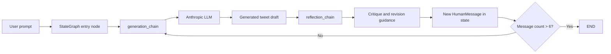
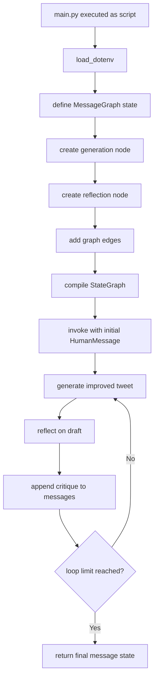
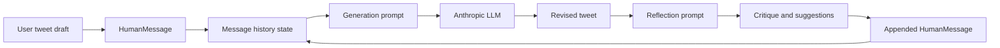
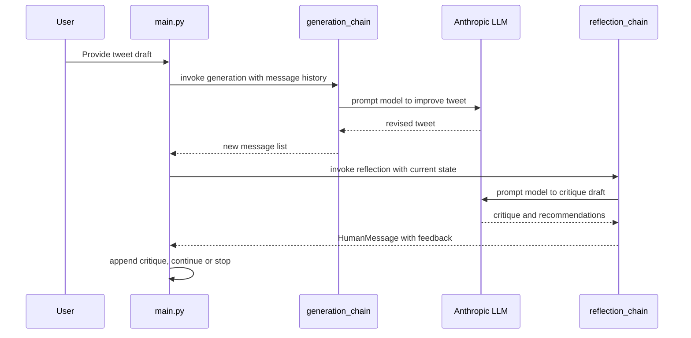
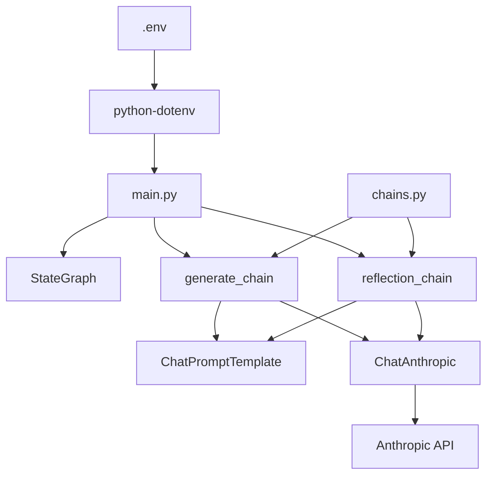

# Reflection Agents

A minimal, code-first example of a reflection loop in an LLM-powered agent system. This repository demonstrates how a model can critique its own draft, revise it, and repeat until the output is stronger or the loop reaches a stopping condition.

The implementation is intentionally small and readable: a LangGraph state graph orchestrates a generation step and a reflection step, while LangChain and Anthropic provide the LLM integration.

Reflection is a prompting strategy used to imporve the quality and success rate of agents and similar AI Systems.

They prompt the LLMs to reflect on its past actions allowing it prompt and learn overtime.


## Table of contents

- [Overview](#overview)
- [What this project does](#what-this-project-does)
- [Architecture and design](#architecture-and-design)
- [Repository structure](#repository-structure)
- [File-by-file documentation](#file-by-file-documentation)
- [Technologies used](#technologies-used)
- [Core concepts](#core-concepts)
- [Execution flow](#execution-flow)
- [Installation and setup](#installation-and-setup)
- [Usage examples](#usage-examples)
- [Testing, quality, and debugging](#testing-quality-and-debugging)
- [Security and configuration considerations](#security-and-configuration-considerations)
- [Build, deployment, and CI/CD](#build-deployment-and-cicd)
- [Contribution and extension guide](#contribution-and-extension-guide)
- [Limitations and future improvements](#limitations-and-future-improvements)
- [Glossary](#glossary)
- [Documentation quality checklist](#documentation-quality-checklist)

## Overview

This repository is a compact Python prototype for reflective AI generation. Its central idea is simple:

1. An initial prompt asks the model to create or improve a tweet.
2. A reflection step reviews the generated output and offers critique.
3. The model revises the draft based on that critique.
4. The loop continues until the system decides the output is good enough or a limit is reached.

The project is not a web application or a full platform. It is an educational and experimental agent pattern built around LangGraph and LangChain.

The repository is intentionally small and direct, which makes it useful as a reference implementation for:

- reflection-based prompting
- iterative self-critique loops
- stateful graph orchestration
- tool-free agent patterns built from message history
- prompt chaining with a simple generation/reflection split

## What this project does

At runtime, the script in [main.py](main.py) creates a LangGraph state machine that starts with a user message asking for a stronger tweet. The system then:

- passes the current message history into a generation chain
- asks an Anthropic-hosted LLM to produce an improved tweet draft
- feeds that message history into a reflection chain
- converts the reflection output into a new human message that informs the next generation pass

The loop exits when the message count exceeds six entries or when the graph reaches its terminal condition. The resulting conversation is a plain Python object graph, not a persistent database or web service.

This makes the repository a useful demonstration of a simple agentic reflection loop rather than a full application framework.

## Architecture and design

### High-level architecture



### Design characteristics

The implementation follows a few very specific patterns:

- Stateful graph orchestration via `StateGraph` from LangGraph.
- Message-based state management using `MessagesState` and `add_messages`.
- Prompt-chaining using `ChatPromptTemplate` with a system prompt plus the message history.
- Reflection as a second prompt that critiques the previous response and produces revision guidance.
- Graph-level control flow using a conditional edge and a stopping rule.

This is a classic “generate → reflect → regenerate” pattern. The architecture is intentionally minimal but demonstrates a realistic agent loop.

### Module responsibility boundaries

- [main.py](main.py): defines the graph, nodes, control logic, and the sample invocation.
- [chains.py](chains.py): creates the prompt templates and configures the Anthropic LLM client.
- [pyproject.toml](pyproject.toml): declares Python requirements and project metadata.
- [flow.png](flow.png): a generated diagram representing the project workflow.

## Repository structure

```text
.
├── .gitignore
├── .python-version
├── README.md
├── chains.py
├── flow.png
├── main.py
├── pyproject.toml
├── uv.lock
└── .venv/                # created locally by uv or virtualenv, not tracked in Git
```

### Directory and file purpose

- `.gitignore`: ignores local environment and editor artifacts.
- `.python-version`: pins the Python version expected by the project.
- `README.md`: project documentation.
- `chains.py`: prompt configuration and LLM creation.
- `main.py`: graph definition and example execution.
- `pyproject.toml`: project metadata and dependencies.
- `uv.lock`: lockfile produced by uv package management.
- `flow.png`: diagram export of the graph.

## File-by-file documentation

| File or path | Purpose | Key implementation details | Related modules |
| --- | --- | --- | --- |
| [main.py](main.py) | Application entry point and graph runtime | Defines `MessageGraph`, creates `StateGraph`, adds generation/reflection nodes, and invokes the compiled graph | [chains.py](chains.py) |
| [chains.py](chains.py) | Prompt templates and LLM connection layer | Builds `reflection_prompt`, `generation_prompt`, and `ChatAnthropic` client using environment variables | [main.py](main.py) |
| [pyproject.toml](pyproject.toml) | Python project configuration | Declares package metadata and dependencies for LangChain, LangGraph, Anthropic integration, and tooling | project metadata only |
| [README.md](README.md) | Project documentation | Describes purpose, architecture, setup, and usage | all files |
| [flow.png](flow.png) | Visualization of workflow | Captures the generated graph flow, useful for understanding the reflection loop without reading all code | [main.py](main.py) |
| [.gitignore](.gitignore) | Local environment hygiene | Excludes Python bytecode, virtual environments, and editor metadata | local workflow |
| [.python-version](.python-version) | Version pin | Pins the expected Python interpreter version | runtime environment |
| [uv.lock](uv.lock) | Dependency lock | Stores the resolved package graph for reproducibility | [pyproject.toml](pyproject.toml) |

### [main.py](main.py)

This file is the actual runtime entry point. It:

- imports `load_dotenv` and loads environment variables from a local `.env` file when present
- defines `MessageGraph`, a typed state schema where the graph stores `messages`
- creates a `StateGraph` instance
- adds the generation node and reflection node
- defines a conditional edge function named `should_continue`
- compiles the graph as `main_graph`
- invokes it with a sample tweet-improvement prompt

The key logic is:

```python
if len(state["messages"]) > 6:
    return END
return REFLECTION_CHAIN
```

That limitation makes the loop finite. The graph is deliberately compact and demonstrates workflow control without an external server or database.

### [chains.py](chains.py)

This file contains the prompt engineering and model configuration for the agent:

- `system_message`: defines the critique persona for the reflection step
- `generation_system_message`: defines the generation persona
- `reflection_prompt`: binds system instructions and message history
- `generation_prompt`: binds generation instructions and message history
- `llm`: configures `ChatAnthropic` with model, base URL, API key, and `temperature=0`

It uses environment variables, which are expected to be set before running the script:

- `FCC_MODEL`
- `FCC_BASE_URL`
- `FCC_API_KEY`

The exact model and base URL are not defined in the repo; they must be supplied from the developer environment.

## Technologies used

| Technology | Category | Location in repository | Purpose in this project |
| --- | --- | --- | --- |
| Python | Programming language | [main.py](main.py), [chains.py](chains.py), [pyproject.toml](pyproject.toml) | Main implementation language |
| LangGraph | Agent orchestration | [main.py](main.py) | Manages the stateful generation-reflection graph |
| LangChain | LLM application framework | [chains.py](chains.py) | Builds prompts and composes model calls |
| LangChain Anthropic integration | Model provider integration | [chains.py](chains.py) | Connects the project to an Anthropic-hosted LLM |
| Anthropic API | External LLM backend | [chains.py](chains.py) | Generates and critiques tweet content |
| python-dotenv | Environment management | [main.py](main.py) | Loads local environment variables from `.env` |
| uv | Package manager | [uv.lock](uv.lock) | Lockfile and dependency management tool |
| GitHub Actions / CI | build pipeline | not present | No workflow definitions were found at the time of inspection |

### Dependency evidence

The project declares the following dependencies in [pyproject.toml](pyproject.toml):

```toml
[project]
name = "reflection-agents"
version = "0.1.0"
requires-python = ">=3.14"
dependencies = [
    "black>=26.10.1",
    "isort>=9.0.2",
    "langchain>=1.4.4",
    "langchain-anthropic>=1.7.5",
    "langgraph>=1.2.14",
    "python-dotenv>=1.2.4",
]
```

This is a Python-first, LLM-agent workflow project with no frontend, database, or web framework.

## Core concepts

### 1. Reflection loop

The central design pattern is reflection: the AI system reviews its own output and improves it through subsequent generation passes.

This is implemented by the graph in [main.py](main.py), where a generation node is followed by a reflection node, which in turn feeds back into the generation step. This creates an iterative improvement loop without a hardcoded algorithmic objective beyond the prompt itself.

### 2. Message-state graph

The graph uses a typed state schema:

```python
class MessageGraph(TypedDict):
    messages: Annotated[list[BaseMessage], add_messages]
```

This is a strong indication of a conversational state model. Each new model output is appended to the message list, preserving the conversation and enabling the prompt to consider previous critique and revisions.

### 3. Prompt chaining

The project uses `ChatPromptTemplate.from_messages(...)` to create a system prompt and message stack for both generation and reflection. This pattern is implemented in [chains.py](chains.py).

The prompts are not static text files; they are Python objects composed at runtime.

### 4. Controlled looping with graph edges

The `should_continue` function enforces a maximum conversation length:

```python
if len(state["messages"]) > 6:
    return END
return REFLECTION_CHAIN
```

This is the project’s main guardrail. Without it, the loop could run indefinitely and waste model tokens.

### 5. LLM as a critique engine

The reflection prompt is intentionally written to review tweet quality, length, virality, and style. It acts like a social-media copy editor, not a generic reasoning engine. The model is instructed to provide detailed recommendations instead of just a yes/no verdict.

## Execution flow

### Application execution path



### Startup sequence

1. `main.py` imports environment configuration and initializes dotenv.
2. The graph is built using `StateGraph`.
3. A generation node calls `generate_chain.invoke(...)`.
4. A reflection node calls `reflection_chain.invoke(...)`.
5. The graph loops until the message count threshold triggers termination.
6. The final result is printed to stdout.

### Data flow



This shows how the system treats the conversation as both the input and the memory of the reflection loop.

## Installation and setup

### Prerequisites

- Python 3.14 or later, as declared in [pyproject.toml](pyproject.toml)
- An Anthropic-compatible API endpoint and API key
- A local environment or virtual environment for Python packages

### Recommended setup with uv

Because a `uv.lock` file is present, `uv` is the most natural package manager for this repository.

```bash
uv sync
```

Then activate the environment:

```bash
source .venv/bin/activate
```

### Alternative setup with pip

```bash
python -m venv .venv
source .venv/bin/activate
pip install -e .
```

### Required environment variables

Create a local `.env` file in the repository root with values similar to the following:

```env
FCC_MODEL=claude-3-5-sonnet-20241022
FCC_BASE_URL=https://api.anthropic.com
FCC_API_KEY=your_api_key_here
```

> Replace the example values with real values appropriate for your Anthropic-compatible endpoint. Do not commit secrets to source control.

### Environment variable table

| Variable | Required | Purpose | Example |
| --- | --- | --- | --- |
| `FCC_MODEL` | Yes | Selects the model used by the generation and reflection chains | `claude-3-5-sonnet-20241022` |
| `FCC_BASE_URL` | Yes | Base URL for the AI provider | `https://api.anthropic.com` |
| `FCC_API_KEY` | Yes | Authentication token for the provider | `sk-ant-...` |

## Usage examples

### Running the script

```bash
python main.py
```

This executes the graph and prints the final reflection result in the terminal.

### Example input currently embedded in the project

The script hardcodes a sample tweet-improvement task:

```python
inputs = {
    "messages": [
        HumanMessage(
            content='''
Make this tweet better:
@SayantanPaul
- newly Tool Calling feature is seriously underrated.

After a long wait, it's here - making the implementation of agents across different models with function calling - super easy.

Made a video covering their newest blog post
'''
        )
    ]
}
```

This demonstrates the project’s intended use: improving a draft social-media post with iterative criticism and revision.

### Important usage note

This repository does not expose a CLI with subcommands or a web API. The primary “usage” is to run the script directly after configuring the environment variables.

## Testing, quality, and debugging

### Testing status

At the time of inspection, there are no test files, no test configuration in [pyproject.toml](pyproject.toml), and no test directories in the repository root. This means the project is currently a prototype, not a fully instrumented test suite.

### Linting and formatting tools

The project includes `black` and `isort` in its dependencies, which suggests the repo intends to support formatting and import sorting:

```bash
black .
isort .
```

### Debugging guidance

If the project fails, the most likely issues are:

- missing environment variables
- invalid or expired API key
- mismatched base URL format
- Python version mismatch
- dependency installation problems

Useful debugging steps:

1. Confirm the Python version matches the requirement in [pyproject.toml](pyproject.toml).
2. Verify the `.env` file exists and contains all required keys.
3. Print the environment variables in a safe local shell to check they are loaded.
4. Run the script directly with `python main.py` to inspect the full stack trace.
5. Check whether `FCC_BASE_URL` ends with `/v1`; the code strips the suffix using `removesuffix('/v1')` before connecting.

## Security and configuration considerations

- Secrets are expected to live in a local `.env` file, not checked into version control.
- The code loads environment variables with `load_dotenv()`, which is convenient for local development.
- API credentials are used directly in the runtime configuration of `ChatAnthropic`.
- There is no explicit authentication layer or authorization system because this is not a multi-user application.
- There is no database, storage layer, or exposed network port to secure.

The project is a local experiment and not a production-grade system. It should be treated as a learning or prototyping artifact unless additional safeguards are added.

## Build, deployment, and CI/CD

### Build process

The repository does not include a Dockerfile, Compose file, deployment manifest, or package build pipeline. There is no verified build or release process in the repo.

### CI/CD status

No GitHub Actions workflow files were found during inspection, so there is no automated CI pipeline configured at the repository level.

### Deployment status

The project is a script-oriented prototype and does not appear to be deployed as a service or package in this repository.

## Contribution and extension guide

This project is small enough that contributing is straightforward.

### Good extension points

- Add more structured evaluation prompts for content quality.
- Add a stored memory of previous attempts.
- Add different reflection styles for tone, clarity, or engagement.
- Turn the script into a reusable function that accepts arbitrary input messages.
- Add a CLI wrapper with arguments for model, prompt, or iteration limit.

### Architectural guidance

If you extend this project, keep the clear separation between:

- prompt construction (`chains.py`)
- graph orchestration (`main.py`)
- runtime environment configuration

That separation keeps the prototype readable as it grows in complexity.

### Validation suggestions

Before contributing changes, verify:

```bash
python main.py
```

Then run any formatting tools you rely on:

```bash
black .
isort .
```

Because there are no automated tests, quality validation is currently driven by direct execution and code review.

## Limitations and future improvements

### Confirmed limitations

- The repository is a minimal prototype, not a production app.
- There is no test suite.
- The project depends on environment variables and a live external AI endpoint.
- The graph has a fixed maximum message count of 6 before stopping.
- The functionality is tuned specifically for tweet improvement, not generalized content generation.
- There is no persistence, retry logic, or robust error handling beyond Python exceptions.

### Potential future improvements

- Add a configuration module for default prompt and model settings.
- Add retries and exponential backoff for LLM failures.
- Add structured output schemas for stronger generation guarantees.
- Add a CLI interface with arguments for prompt text and iteration count.
- Add monitoring, tracing, and logging for agent steps.
- Expand the prompt system beyond tweet writing to domain-specific content generation.

## Sequence diagram



## Module dependency diagram



## Glossary

- Reflection loop: a prompting pattern where the model critiques and revises its own output iteratively.
- LangGraph: a graph-based orchestration framework for stateful LLM workflows.
- LangChain: a framework for composing prompts, models, and data flows.
- MessagesState: a state schema used to maintain ordered conversation history.
- Prompt template: a structured prompt definition that includes system instructions and variable message history.
- Generation chain: the branch that produces the next output.
- Reflection chain: the branch that critiques the output and suggests actions to improve it.
- HumanMessage: the message object representing user or assistant content in the LangChain/LangGraph conversation model.

## Documentation quality checklist

This README was written from the repository’s actual sources and configuration, including:

- [main.py](main.py)
- [chains.py](chains.py)
- [pyproject.toml](pyproject.toml)
- [uv.lock](uv.lock)
- [.python-version](.python-version)
- [.gitignore](.gitignore)

Verified facts in this document:

- The repository is a Python project built around LangGraph and LangChain.
- The core workflow is a generation-reflection loop.
- The model integration is Anthropic-based and configured through environment variables.
- The project currently has no test suite and no CI/CD workflow files.
- The implementation is a local prototype rather than a packaged deployment application.

## Final notes

This is a small but instructive repository for understanding how a reflection-based agent can be implemented without a large framework or application backend. The essential idea is not hidden behind lots of infrastructure: a graph, prompt templates, and a simple model loop are enough to demonstrate the pattern clearly.

If you want to modify or extend it, start with the prompt definitions in [chains.py](chains.py) and the graph control flow in [main.py](main.py). Those two files contain the project’s real runtime logic.

For developers learning agentic patterns, this project is best read as a minimal blueprint for: prompt-based self-critique, graph state management, and iterative LLM improvement.
